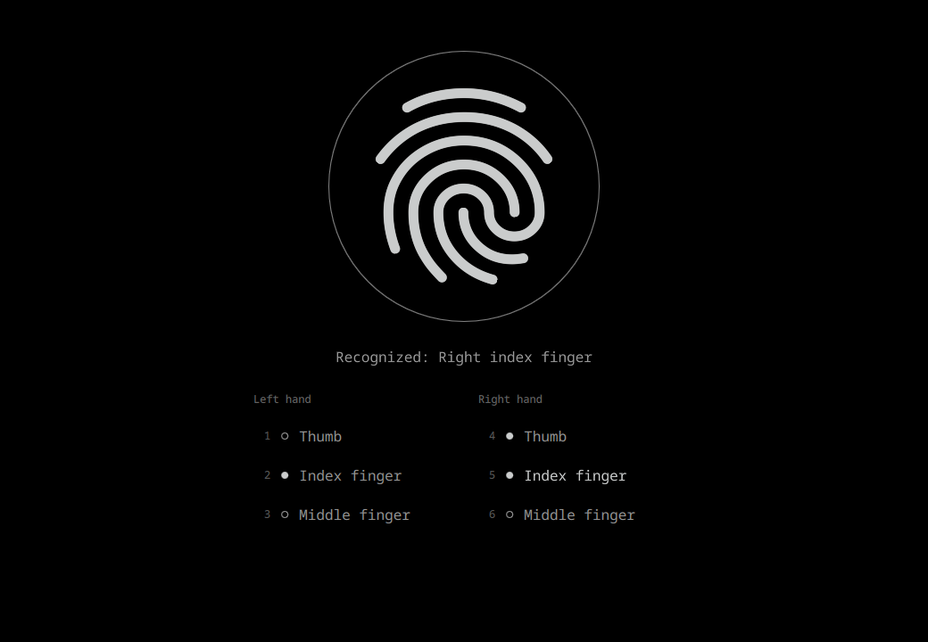

# fingerprint-omarchy

Enroll, test and delete your fingerprints from an
[Omarchy](https://omarchy.org) shell panel. It looks and reads like Omarchy's
own fingerprint panel (`omarchy.fingerprint`, Omarchy 4.6), the big print on a
dark scrim with one status line, and does what that panel doesn't: choosing
which finger to enroll, testing your prints, and deleting them. Omarchy's
panel registers the next free finger and sets sudo, polkit and the lock screen
up; this one needs no root and leaves that setup to it.



- **The print**: it arrives as a scratchy transmission, as Omarchy's does, and
  lights up along its ridges from the core outward with every scan the reader
  accepts, with Omarchy's own words under it (touch the sensor, lift and touch
  again, not centered, …). Once a finger is in, the picture breaks up and
  comes back on your fingers.
- **Six fingers** under it: thumb, index and middle finger of each hand, a dot
  marking those enrolled. Left hand in the first column, right hand in the
  second (mirrored in right-to-left languages).
- **Testing**: with the cursor on the print, touch the reader with any
  enrolled finger; the print lights up and the status line names the finger it
  recognized, which also lights up below. With a single finger enrolled any
  fprintd tells which one; with several, on a reader that identifies (matches
  against all prints at once), stock fprintd only says a print matched, and
  naming the finger needs an fprintd that emits `VerifyMatchedFinger` (see
  *Requirements*).
- **All from the keyboard**:

  | Key | Does |
  |-----|------|
  | Arrows, Tab / Shift+Tab | Move between the print and the fingers |
  | 1–6 | Jump to a finger (left thumb … right middle finger) |
  | Enter / Space | Enroll (or re-enroll) the finger; on the print, test; after a failed scan, try again |
  | Delete / Backspace | Ask to delete the finger; Enter confirms |
  | V | Test |
  | R / F5 | Look for the reader again |
  | Escape | Cancel the scan or test running, or close |

- In every language Omarchy offers under *Setup › Language*. The lines the
  two panels share are Omarchy's, with its translations
  (`dev/sync-upstream-strings` copies them from an installed Omarchy).

## How it works

The panel is a shell plugin, `lbssousa.fingerprint` (`kind: overlay`). The
print and its transmission are drawn as in Omarchy's panel (MIT), whose
ridges come from the Material Design fingerprint icon (Apache 2.0).
While it's open it runs `fprint-helper`, a small Python program that talks to
fprintd on the system bus (Quickshell has no D-Bus of its own in QML, and the
`fprintd-*` tools neither say how many scans an enrollment takes nor stop
cleanly). They speak one JSON object per line over the helper's stdin and
stdout; the protocol is described at the top of `fprint-helper`.
Closing the panel stops the helper, which stops any scan and releases the
reader. If fprintd restarts under a scan (Omarchy restarts it after resume,
and Goodix 53XD setups run a watchdog that restarts it when the goodix538d
driver loses sync, usually on the first scan after a cancelled one), the
helper claims the reader again and starts the scan over, up to twice.

Only the default reader is used. fprintd asks for your password (through the
shell's polkit agent) the first time you enroll or delete a print, and keeps
the answer for a few minutes. Nothing needs root.

The panel doesn't set PAM up: for sudo, polkit and the lock screen to ask
for a fingerprint, an administrator runs Omarchy's
`omarchy-setup-security-fingerprint` once (its full-screen panel from Omarchy
4.6, a terminal before), and this panel says so while it isn't.

## Requirements

- Omarchy 4.5 or 4.6 (the Quattro shell).
- fprintd and a reader it supports. *Setup › Security › Fingerprint* installs
  fprintd; so does `sudo pacman -S fprintd`. Optional: an fprintd patched to
  emit the `VerifyMatchedFinger` signal, so the test names the finger that
  matched when several are enrolled: the `verify-matched-finger` branch of
  [lbssousa/fprintd](https://github.com/lbssousa/fprintd/tree/verify-matched-finger),
  whose `packaging/PKGBUILD` replaces Arch's fprintd (`makepkg -si`).
- `python` and `python-gobject`, both part of every Omarchy install.

## Install

```sh
omarchy plugin add https://github.com/lbssousa/fingerprint-omarchy.git --enable
```

Open it with:

```sh
omarchy-shell shell summon lbssousa.fingerprint '{}'
```

To have *Setup › Security › Fingerprint* open it instead of Omarchy's setup,
add to `~/.config/omarchy/extensions/omarchy-menu.jsonc` (Omarchy's setup
stays at `omarchy-setup-security-fingerprint`, for the PAM part):

```jsonc
"setup.security.fingerprint": {"action":"omarchy-shell shell summon lbssousa.fingerprint '{}'"},
```

Update with `omarchy plugin update lbssousa.fingerprint`.

### As an Arch package

`packaging/` builds `fingerprint-omarchy`, which installs the plugin to
`/usr/share/fingerprint-omarchy/plugin` and an `omarchy-fingerprint` command
that opens it (or the terminal script, when the plugin is off):

```sh
cd packaging && makepkg -si
ln -sfn /usr/share/fingerprint-omarchy/plugin ~/.config/omarchy/plugins/lbssousa.fingerprint
omarchy-shell shell rescanPlugins
omarchy-shell shell enablePlugin lbssousa.fingerprint '{}'
```

The running shell only looks for plugins when it starts or is asked to
rescan; until then `enablePlugin` answers `unknown`.

## Remove

```sh
omarchy plugin remove lbssousa.fingerprint
```

(`sudo pacman -R fingerprint-omarchy` and
`rm ~/.config/omarchy/plugins/lbssousa.fingerprint` for the package.) Drop the
`setup.security.fingerprint` line if you added it to the menu. Removing the
plugin leaves your prints in fprintd and the PAM setup as they are: delete
prints in the panel first, or later with `fprintd-delete $USER`.

## Development

```sh
just test      # node tests (model, catalogs), python tests (helper), lint, validation
just dev       # the panel in its own Quickshell instance, on the real reader
just dev ar    # ... in Arabic (right to left)
just link      # this checkout's plugin in the real shell
just pkg       # the Arch package
```

`just dev` runs `dev/shell.qml` from a temporary folder that links the
plugin's files and the shell's `Commons` and `Ui` from
`/usr/share/omarchy/shell`; the checkout itself carries no symlinks, which
`omarchy plugin add` refuses.

## License

MIT
