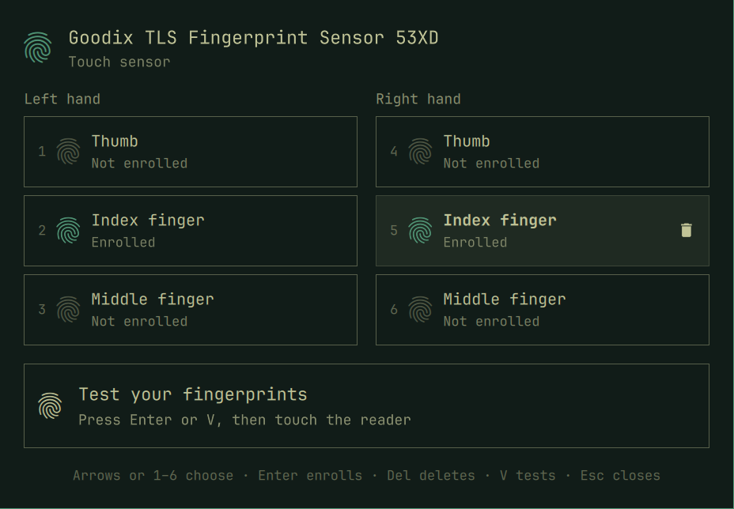

# fingerprint-omarchy

Enroll, test and delete your fingerprints from an
[Omarchy](https://omarchy.org) shell overlay, instead of the terminal script
behind *Setup › Security › Fingerprint*. Modelled on the fingerprint dialog of
GNOME Settings and on the Security page of
[lbssousa/noctalia](https://github.com/lbssousa/noctalia/tree/feat/security-hardware),
and themed like the shell's polkit agent.



- **Six fingers**: thumb, index and middle finger of each hand, as tiles that
  show which are enrolled. Left hand in the first column, right hand in the
  second (mirrored in right-to-left languages).
- **Enrollment card**: the fingerprint inside a rounded square frame that
  fills clockwise as the reader accepts each scan ("Scan 3 of 17"), with the
  reader's feedback (lift and touch again, centre your finger, …). Readers
  that don't report a scan count get a spinning frame.
- **Test area**: touch the reader with any enrolled finger; the card says
  which one it recognized and marks its tile.
- **All from the keyboard**:

  | Key | Does |
  |-----|------|
  | Arrows, Tab / Shift+Tab | Move between the tiles and the test area |
  | 1–6 | Jump to a finger (left thumb … right middle finger) |
  | Enter / Space | Enroll (or re-enroll) the finger; on the test area, test |
  | Delete / Backspace | Ask to delete the finger; Enter confirms |
  | V | Test |
  | R / F5 | Look for the reader again |
  | Escape | Cancel the scan or test running, or close |

- In every language Omarchy offers under *Setup › Language*.

## How it works

The overlay is a shell plugin, `lbssousa.fingerprint` (`kind: overlay`).
While it's open it runs `fprint-helper`, a small Python program that talks to
fprintd on the system bus (Quickshell has no D-Bus of its own in QML, and the
`fprintd-*` tools neither say how many scans an enrollment takes nor stop
cleanly). They speak one JSON object per line over the helper's stdin and
stdout; the protocol is described at the top of `fprint-helper`.
Closing the overlay stops the helper, which stops any scan and releases the
reader. If fprintd restarts under a scan (Omarchy restarts it after resume,
and Goodix 53XD setups run a watchdog that restarts it when the goodix538d
driver loses sync, usually on the first scan after a cancelled one), the
helper claims the reader again and starts the scan over, up to twice.

Only the default reader is used. fprintd asks for your password (through the
shell's polkit agent) the first time you enroll or delete a print, and keeps
the answer for a few minutes. Nothing needs root.

The overlay doesn't set PAM up: for sudo, polkit and the lock screen to ask
for a fingerprint, an administrator still runs
`omarchy-setup-security-fingerprint` (or `omarchy-mu-setup-security-fingerprint`
with [omarchy-multiuser](https://github.com/lbssousa/omarchy-multiuser)), and
the overlay says so while it isn't. With omarchy-multiuser, the lock screen
picks up new prints by itself.

## Requirements

- Omarchy 4.5 (the Quattro shell).
- fprintd and a reader it supports. *Setup › Security › Fingerprint* installs
  fprintd; so does `sudo pacman -S fprintd`.
- `python` and `python-gobject`, both part of every Omarchy install.

## Install

```sh
omarchy plugin add https://github.com/lbssousa/fingerprint-omarchy.git --enable
```

Open it with:

```sh
omarchy-shell shell summon lbssousa.fingerprint '{}'
```

To have *Setup › Security › Fingerprint* open it instead of the terminal
script, add to `~/.config/omarchy/extensions/omarchy-menu.jsonc`:

```jsonc
"setup.security.fingerprint": {"action":"omarchy-shell shell summon lbssousa.fingerprint '{}'"},
```

[omarchy-multiuser](https://github.com/lbssousa/omarchy-multiuser)'s menu
block does that already.

Update with `omarchy plugin update lbssousa.fingerprint`.

### As an Arch package

`packaging/` builds `fingerprint-omarchy`, which installs the plugin to
`/usr/share/fingerprint-omarchy/plugin` and an `omarchy-fingerprint` command
that opens it (or the terminal script, when the plugin is off):

```sh
cd packaging && makepkg -si
ln -sfn /usr/share/fingerprint-omarchy/plugin ~/.config/omarchy/plugins/lbssousa.fingerprint
omarchy-shell shell rescanPlugins
omarchy-shell shell enablePlugin lbssousa.fingerprint '{}'
```

The running shell only looks for plugins when it starts or is asked to
rescan; until then `enablePlugin` answers `unknown`.

## Remove

```sh
omarchy plugin remove lbssousa.fingerprint
```

(`sudo pacman -R fingerprint-omarchy` and
`rm ~/.config/omarchy/plugins/lbssousa.fingerprint` for the package.) Drop the
`setup.security.fingerprint` line if you added it to the menu. Removing the
plugin leaves your prints in fprintd and the PAM setup as they are: delete
prints in the overlay first, or later with `fprintd-delete $USER`.

## Development

```sh
just test      # node tests (model, catalogs), python tests (helper), lint, validation
just dev       # the overlay in its own Quickshell instance, on the real reader
just dev ar    # ... in Arabic (right to left)
just link      # this checkout's plugin in the real shell
just pkg       # the Arch package
```

`just dev` runs `dev/shell.qml` from a temporary folder that links the
plugin's files and the shell's `Commons` and `Ui` from
`/usr/share/omarchy/shell`; the checkout itself carries no symlinks, which
`omarchy plugin add` refuses.

## License

MIT
